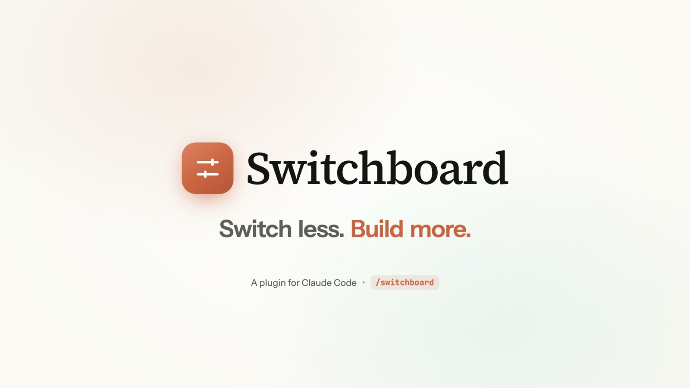

# Switchboard `beta`

[Website](https://hassamali898.github.io/switchboard/) · [Releases](https://github.com/hassamali898/switchboard/releases) · MIT



One Claude Code plugin with separate features you switch on or off from one pane (`/sb`), in the desktop
Code tab and the terminal:

- **Inbox** — Slack, Gmail, Calendar, GitHub and Jira in one live, color-coded list behind a bell. Drafts
  three replies on Haiku in its own session; you send with a 5 s Undo. Meeting cards before each meeting.
- **Auto rules** — rules you make from the chat (`/sb-auto`). Ask first by default; nothing ever sends
  without a saved rule, a named person and a clear request.
- **Files** — a live tree of what Claude reads, edits and commits.
- **Replay** — every edit of the last turns, step by step (`/sb-replay`).
- **Blast Radius** — holds commands that delete or overwrite things and shows what they would touch.
- **Agents** — the subagents Claude runs, with progress, model and cost.
- **Reflect** — notices when you correct Claude and offers to save the rule to CLAUDE.md.
- **Cache Tax** — holds a costly message when the prompt cache has gone cold.

Everything runs locally: no server, no cloud database; tokens live in your OS keychain.

## Layout

| Path | What it is |
| --- | --- |
| `.claude-plugin/plugin.json`, `hooks/` | The plugin. `hooks/register.tsx` holds every engine call; `hooks/core/`, `hooks/ui/` and `hooks/features/` are pure: rules, views, pictures |
| `types/index.d.ts` | The plugin's `$.state` contract |
| `watcher/` | Python: adapters, queue, rules, auth, the guarded send path (`actions.py`), the CLI the pane calls (`cli.py`) |
| `config/` | `priorities.example.yaml`, `rules.example.yaml` (phase 4), `slack-app-manifest.yaml` |
| `install.sh`, `scripts/` | The installer; `bootstrap.sh` builds or repairs `.venv` |
| `tests/` | `pytest` for Python; `tests/*.test.tsx` for `claude plugin test` |
| `docs/`, `design/` | The plan and the approved design (the handoff package) |

## Install

> **Beta (1.0.0-beta.2).** Needs Python 3.10+, Claude Code 2.1.295 or newer, and function hooks switched on:
> add `"CLAUDE_CODE_ENABLE_FUNCTION_HOOKS": "1"` under `env` in `~/.claude/settings.json`.

From the marketplace, inside Claude Code:

```
/plugin marketplace add hassamali898/switchboard
/plugin install switchboard@switchboard
```

Or download the [latest release](https://github.com/hassamali898/switchboard/releases) and run the installer:

```bash
./install.sh
```

Then start a new Claude Code session (the desktop Code tab or `claude` in a terminal) and type `/sb-inbox`. Everything else happens in the inbox, with buttons.

**Connector permission.** Switchboard reads Gmail, Slack and Jira through Claude's connectors, and those calls follow
your Claude Code permission rules. If a source says **Needs your OK**, press **Allow**: it puts the exact read-only
tools in your prompt, and Claude adds them to `permissions.allow` after you confirm. Tools that send are never added
for you. **Stuck?** Switchboard runs inside Claude Code, so ask Claude what you see; it can read the plugin's state.

The installer:

- builds the plugin's Python environment, so the first session starts at once
- adds three keys to the `env` block of `~/.claude/settings.json` and keeps a backup next to it:
  - `CLAUDE_CODE_ENABLE_FUNCTION_HOOKS=1`, because function hooks are early access in Claude Code
  - `CLAUDE_CODE_PLUGIN_DIRS`, so every session loads the plugin from this folder
  - `CLAUDE_CODE_PLUGIN_DIR_WATCH=1`, so open desktop sessions reload the plugin when its files change

It is safe to run again. To remove the plugin:

```bash
./install.sh --uninstall
```

If the Python environment goes missing or `pyproject.toml` changes, the plugin rebuilds it by itself on the next session.

## Connect your sources (in the pane)

Everything is a button; no commands to type. The first session opens the inbox with a **Connect your sources** card, and **Settings** (top right of the inbox) shows the same choices any time. Each choice says why you would pick it and what to know about it.

**Slack**

| Choice | Why | Good to know |
| --- | --- | --- |
| **Connect Slack directly** (recommended) | Messages show up instantly: Slack sends them to us, so nothing is checked over and over | A two-minute setup; some workspaces need an admin to approve the app |
| Claude's Slack connection | No Slack app to create | Not offered: it could only check repeatedly, which is slow and runs into Slack's limits |

The steps:

1. **Open Slack** brings up Slack's Create App form, filled in from [config/slack-app-manifest.yaml](config/slack-app-manifest.yaml). Create the app and install it to the workspace.
2. Copy the User OAuth Token (`xoxp-…`) and press **Paste code 1**.
3. Generate an App-Level Token with `connections:write` (`xapp-…`), copy it and press **Paste code 2**.

The codes go from the clipboard straight into the OS keychain. They are never shown, and the clipboard is cleared afterwards.

**Gmail**

| Choice | Why | Good to know |
| --- | --- | --- |
| **Use Claude's Gmail connection** (recommended) | Nothing to set up: it uses the Gmail you already connected to Claude | New mail shows up within about 15 s while you work, and every few minutes while you are away. It only works while Claude Code is open |
| Connect Gmail directly | Mail shows up within seconds, even while Claude Code is closed | A one-time Google Cloud setup (about 5 minutes) |

- **Claude's connection:** Switchboard finds the connection by itself. If Gmail isn't connected to Claude yet, the card links to Claude's connector settings.
- **Directly:** turn on Gmail access, create a *Desktop app* sign-in key, download it, then press **Connect Gmail** and sign in. Instant updates are set up for you when your Google project allows it; otherwise Gmail is checked every minute and the card says how to turn them on.

**Try the demo** shows the design's made-up messages. Nothing is sent.

## Account safety

Your accounts matter more than speed, so every source works far below its service's limits and stops by itself when anything looks wrong:

- **Limits:** a minimum gap between calls, plus hourly and daily caps per source. The rules are in `watcher/safety.py` and `hooks/lib/governor.ts`.
- **Gmail through Claude:** checks come at most every 15 s, and only while you're active. Each check is one small search, and an email is fetched only when you open it.
- **Slowing down:** when a service asks us to slow down (HTTP 429, quota), Switchboard waits as long as it was told, then backs off further. After three requests in a row it pauses that source for 30 minutes. The inbox shows a line with the time it will resume, plus a **Resume now** button.
- **Rejected sign-ins:** Switchboard stops that source until you reconnect it. Retrying bad credentials over and over is what gets accounts locked.
- **Slack catch-up:** after a reconnect, Switchboard catches up on your 20 most recent conversations, one call at a time. New connections are spaced at least 20 s apart.
- **One window at a time:** only one Claude Code window checks Gmail. The others see the same mail through the shared queue.

## Use

Type `/sb-inbox` to open the inbox. All Switchboard commands start with `sb-` so they never clash with your own.

| Command | What it does |
| --- | --- |
| `/sb-inbox` | Open the inbox (everything else is buttons) |
| `/sb-reply <n>` | Open item #n with reply options |

In **Settings** you can:

- choose how each source connects
- see account safety and press **Resume** when a source is paused
- switch alerts between emoji and text tags
- pause or resume checking
- turn the demo on or off
- remove Switchboard (it asks before doing so)

Keys in the focused pane:

| Keys | Action |
| --- | --- |
| `1`–`9` | Open an item |
| `a` / `b` / `c` | Pick a reply option |
| `s` | Send |
| `u` | Undo |
| `i` | Improve |
| `e` | Edit |
| `d` | Save draft |
| `k` | Skip |
| `m` | Mark all read |
| `o` | Settings |
| `Esc` | Back to the prompt |

## Develop

```bash
.venv/bin/pip install -e '.[dev]' && .venv/bin/python -m pytest -q
```

```bash
npm install && npx tsc -p .
```

```bash
claude plugin validate .
```

```bash
CLAUDE_CODE_ENABLE_FUNCTION_HOOKS=1 claude plugin test .
```

Regenerate `.claude/types/` with `/plugin-types` after a Claude Code update. [docs/DEVELOPING.md](docs/DEVELOPING.md) lists the hooks-module rules this code depends on.

## Safety

- **Sending.** Nothing is sent without your click. Auto rules arrive in phase 4.
- **Guards on every send** (`watcher/actions.py`):
  - the recipient you saw must still be the item's recipient
  - an idempotency key blocks a double send
  - Slack's 40,000-character limit
  - the original is re-read first: deleted blocks the send, edited needs a confirm
  - HTTP 429: wait for Retry-After, then retry once
  - every send goes to the action log with Undo info
- **Message text is data.** Drafting prompts treat it as untrusted. Items that match excluded labels, channels or keywords are never sent to Claude.
- **Tokens.** They stay in the OS keychain (`.env` is only a git-ignored fallback) and are redacted from every error message.
