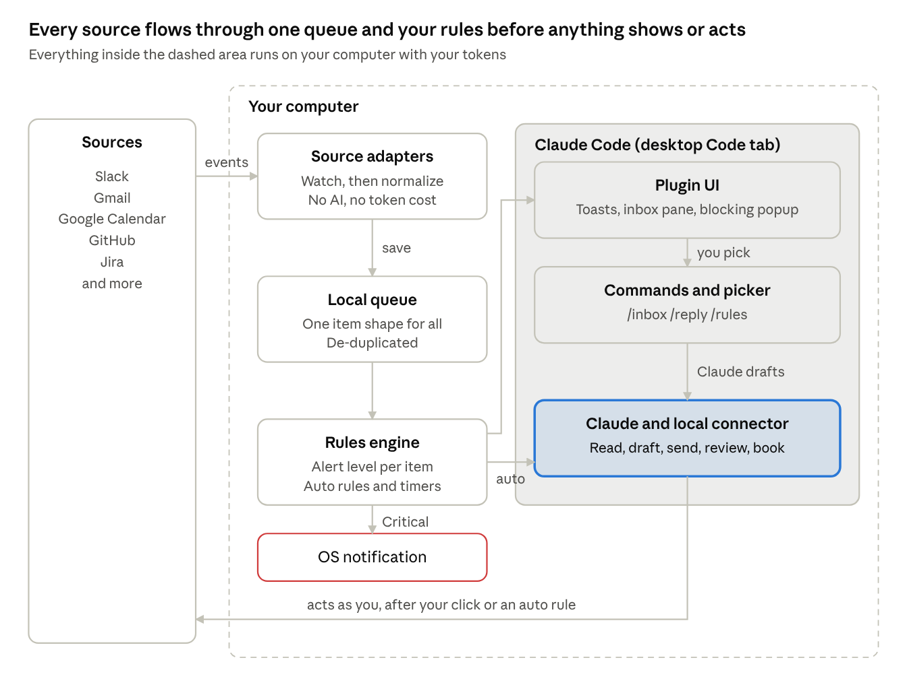
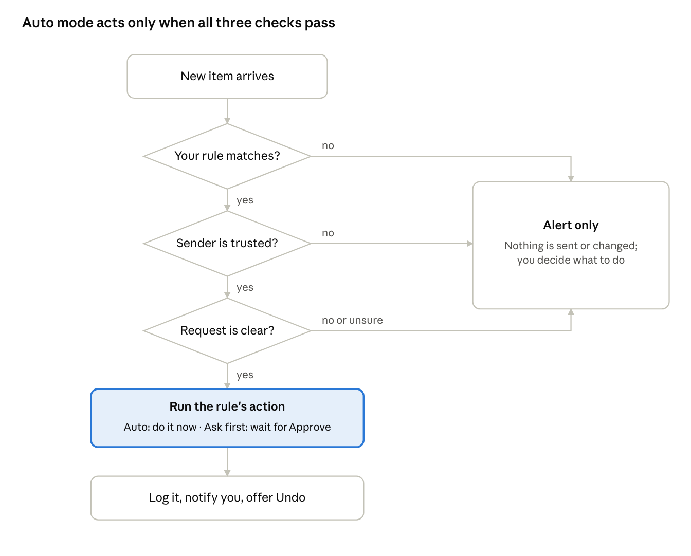
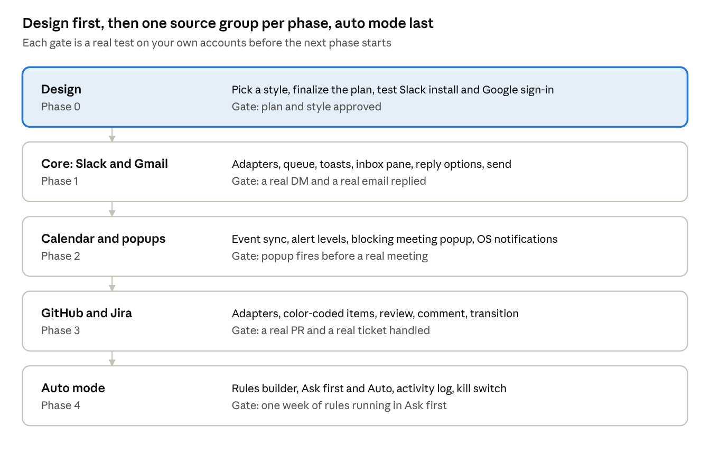

# Inbox Copilot for Claude Code — Plan

Oct 3, 2026 · Alex Doe · working name, final name still open (see Open decisions)

## Overview

Inbox Copilot is a Claude Code plugin that lives in the Claude desktop Code tab and turns Slack, Gmail, Google Calendar, GitHub, Jira and any other connected tool into one live, color-coded inbox. It shows alerts the moment they arrive, blocks the screen for what matters, and can act on its own through rules you write. Everything runs on your computer with your own tokens.

**Goals**

- One unified inbox for every connected source, each with its own icon and color
- Real-time alerts with no AI cost per alert; priority items open a blocking popup
- Meeting reminders that take over the Claude window before a meeting starts
- Reply options on demand: 2 to 3 AI drafts, plus Improve, Custom and Save as draft
- Auto mode: rules with instructions that reply, review PRs, book meetings, update tickets and more, as you
- Lives inside the Claude desktop app (Code tab), not a separate application

**Non-goals for v1**

- No auto action without a rule you wrote, a trusted sender and a clear request
- No hosted server or cloud database; nothing leaves the machine except calls to the sources and Claude
- No multi-user or team version yet (single user)
- No OS-wide screen lock; the blocking popup covers the Claude window, the OS notification covers the rest

## Architecture

Five local parts make one Claude Code plugin that runs in the Claude desktop Code tab: source adapters, a queue, a rules engine, the plugin UI with commands, and Claude with a local connector.

Adapters, queue and rules cost nothing per item. Claude works only when you pick an item or an auto rule passes all its checks; Critical items also raise an OS notification.

## User flows

Every flow ends in an explicit choice; nothing is sent without a final Send confirmation (or an auto rule you saved).

**1. New message arrives (no AI)**

1. The watcher receives the event from Slack Socket Mode, Gmail push, or a 60 s poll (Calendar, GitHub, Jira).
2. It is saved to the local queue with a short number, for example #12.
3. The rules engine sets the alert level; a toast slides in (Normal: 6 s) and the Inbox badge count goes up.
4. Muted senders, bots and your own messages are skipped silently.

**2. Open the inbox**

1. Run `/inbox`, or click the toast in the desktop Code tab.
2. A list shows unread items, newest first: source icon, sender, time, one-line preview, level dot.
3. Pick an item to open it, or choose Mark all read.

**3. Reply with options**

1. Run `/reply 12`, or open an item in the inbox pane.
2. Claude reads the full thread and recent history with that person.
3. Claude shows 3 options: Short, Detailed, and a third that fits the context (for example Ask or Decline).
4. Actions: Send, Improve, Edit, Save draft, Skip.

**4. Improve**

1. Choose Improve, then a preset: Shorter, Friendlier, More formal, Fix grammar, or type an instruction.
2. Claude shows a before and after; pick Use this, Improve again, or Back.

**5. Custom response**

1. Choose Edit and type the message, or type rough notes and pick Polish my notes.
2. Review the result, then continue to Send.

**6. Send**

1. A preview shows recipient, channel or thread, and the final text.
2. After Send, a 5-second countdown with Undo appears; the message is only sent when it ends. Slack messages can also be deleted afterwards; Gmail mail cannot be recalled once sent.

**7. New message from scratch**

1. Run `/send` and describe it, for example: message Ahmed on Slack that I will be 10 minutes late.
2. Claude resolves the person, drafts the text, and goes to the Send step.

## Sources and integrations

Every tool plugs in as a source adapter, so adding GitHub, Jira or anything else later is one new adapter, not a redesign. Slack and Gmail are instant; GitHub, Jira and Calendar changes arrive within about 60 seconds, because their push options need a public server.

| Source | Color | Real-time method | Delay | Alerts on | Actions |
| --- | --- | --- | --- | --- | --- |
| Slack | Aubergine #4A154B | Socket Mode | Instant | DMs, mentions, your threads | Reply, react, send, save draft |
| Gmail | Red #EA4335 | Gmail push via a Pub/Sub pull subscription | 1 to 5 s | New and important mail | Reply, draft, label, archive |
| Google Calendar | Amber #F9AB00 | Event sync every 60 s plus local timers | Reminders exact to the second | Invites, changes, starting soon | Join, accept, decline, create, reschedule |
| GitHub | Graphite #24292F | Notifications API, every 60 s | Up to 60 s | Review requests, mentions, CI failures, PR comments | Review, comment, approve, re-run checks |
| Jira | Atlassian blue #0052CC | JQL search, every 60 s | Up to 60 s | Assigned, mentioned, status changes, comments | Comment, transition, assign, log work |
| Later | Per source | Per adapter | Varies | Confluence, Linear, Notion, Sentry, Teams, Outlook, Figma, Drive comments | Per adapter |

**How an adapter works**

1. Watch: listens or checks for new events using that source's own token.
2. Normalize: turns each event into one common item (source, kind, from, title, body, link, priority, thread).
3. Act: lists the actions that source supports; the UI shows its icon, color and buttons automatically.

**Claude connectors vs. watcher tokens**

- Connectors already added to Claude (Slack, Gmail, Atlassian, GitHub) can be used when Claude reads context or takes an action during a turn.
- The background watcher runs without Claude, so each source also needs its own token for watching. Whether connector sign-ins can be reused for this is an open question to test in phase 0.

## Priority alerts and popups

Each item gets one of four alert levels from your rules; only Critical blocks the Claude window, and it always also sends an OS notification so you see it outside Claude.

| Level | What you see | Example rules |
| --- | --- | --- |
| Critical | Full-window dialog that holds the keyboard, sound, OS notification | Meeting starts in 5 min; message from your lead; #acme-prod incident; CI failing on main |
| High | Toast that stays until dismissed, badge, sound | Review requested on your PR; Jira ticket assigned with priority Highest |
| Normal | Toast for 6 s, badge | Any DM or mention; new email in Primary |
| Quiet | Badge only, no toast | Newsletters, bot messages, FYI channels |

**Rule conditions you can combine:** source, person, email domain, channel, Jira project or priority, GitHub repo or label, keywords, calendar event type, time of day, and focus mode.

**Meeting popup flow**

1. The calendar adapter keeps the next 24 hours of events in sync.
2. At your lead time (default 5 minutes; 1, 3, 5 or 10; per-event override), a Critical dialog opens: countdown ring, title, time, attendees, meeting link.
3. Buttons: Join now (opens the Meet or Zoom link), Snooze 1 min, Snooze 3 min, Not going.
4. If not acted on, it opens again at 1 minute before and at start time.
5. Declined, cancelled or all-day events never trigger it.

**Focus and quiet hours:** a Focus toggle and scheduled quiet hours (default 20:00 to 09:00) lower everything except Critical to Quiet.

## Auto mode

Auto mode is a rules engine: each rule is a trigger, conditions, an action and your own instructions, and it runs only when all three checks below pass. Anything unclear falls back to a normal alert.

Each rule runs in Ask first mode (Claude prepares the action and you press Approve) or Auto mode (it acts and tells you). New rules start in Ask first.

| Rule | Trigger | Conditions | Action and instructions |
| --- | --- | --- | --- |
| Review PRs | Message asks to review a PR, or a GitHub review request | Sender on your team; repo in acme/acme-* | Review the whole PR using your checklist, post comments and a summary review as you |
| Book meetings | Message asks to set up a meeting | Sender has an acme.com address | Find a free 30-minute slot between 11:00 and 18:00, never Friday after 15:00, send the invite, reply with the time |
| Not important | Bot or FYI message, newsletter | Source marked low priority and Claude is sure | Archive and mark read (Undo for 24 h) |
| Jira updates | Ticket assigned to you | Project is SOPH | Comment, move it to In Progress, add it to today's plan |
| Out of office | Any DM while your OOO is on | Not from a Critical contact | Reply with your OOO text and return date |
| Manual command | You type a command | Always yours | For example: book a meeting at 16:00 tomorrow with Ahmed about the auth migration |

**Auto mode in the chat**

- Create a rule by typing, for example `/auto Ahmed Raza: if he asks for a PR review, review it and post comments. If he asks to meet, book 30 min after 2pm.` Claude answers with a rule card (When → Do pairs, Only if chips, Ask first / Auto) and a Save button
- Rules can target one person, a channel, a source or everything
- Running, waiting and finished auto tasks appear in the transcript as live cards with Stop, Approve or Undo
- A band above the prompt always shows what is running, what is waiting and how many rules are on, with Pause all
- `/rules` lists every rule, `/pause` stops all auto actions at once

**Guardrails**

- Text inside a message is data, never a command; it can only trigger a rule you wrote, and only that rule's allowed actions run
- Per rule: allowed actions, allowed repos or projects, a daily cap (default 10), and an off switch
- Everything goes out as you, with no AI name or label; you stay responsible, so check Acme's policy on AI-written reviews
- Every auto action is logged with what triggered it, what was done and an Undo where possible (delete message, cancel invite, revert transition)
- Auto mode runs only while Claude Code is open; otherwise items wait in the queue

## Design system

Claude's own palette (Ivory #FAF9F5, Slate #141413, Clay #D97757, warm grays), serif headings over sans body, and the app's light or dark mode. Exact tokens: `design/tokens/`. Screens: `design/screenshots/`. Terminal rendering uses the same colors with Unicode boxes, emoji and simple text animation.

**Source identity:** every item carries its source's icon on a tinted badge in the source color, plus a text label, so color is never the only cue. Official logos come from each company's brand asset page and are used only to label the source.

**Rules**

- Animations stay under 400 ms, except countdowns, and switch off with reduced motion
- Emoji have a text fallback (for example `[DM]`) for terminals that render them badly
- Never more than three toasts on screen; extra alerts collapse into a "+3 more" counter

## Edge cases

The riskiest cases are a wrong recipient, a double send and lost messages while offline; each has a guard below.

| Area | Case | Handling |
| --- | --- | --- |
| Sending | Wrong recipient or thread | Preview always shows name, channel and thread; Send needs a confirm click |
| Sending | Double click or retry sends twice | Each send has an idempotency key; a repeat within 60 s is blocked |
| Sending | Message changed or deleted before reply | Thread re-read before Send; warn if the original is gone or edited |
| Sending | Slack rate limit (HTTP 429) | Wait for the Retry-After time, then retry once, and show a toast |
| Sending | Long text over Slack's 40,000-character limit | Block Send and offer to shorten |
| Real-time | Computer sleeps or Wi-Fi drops | Auto-reconnect with backoff; on reconnect, fetch everything since the last seen timestamp |
| Real-time | Gmail push stops after 7 days | Watch is renewed daily; fallback check every 60 s if push is silent |
| Real-time | Claude Code is closed | Watcher keeps queueing; the inbox shows the backlog on next open, with an optional OS notification |
| Real-time | Burst of 50+ messages | One summary toast ("+48 more"), no toast flood |
| Real-time | Same message from two events (edit, thread reply) | De-duplicate by message ID; edits update the item in place |
| Noise | Bots, newsletters, own messages | Skipped by default; mute list per sender and channel |
| Noise | Huge channels | Only DMs, mentions and threads you are in, unless a channel is added |
| Content | Attachments, images, code blocks | Shown as file name chips; Claude reads text files only |
| Content | Non-English messages | Drafts reply in the sender's language unless set otherwise |
| Content | Very long email threads | Claude reads the last 10 messages plus a summary of older ones |
| Content | Sensitive mail (HR, finance, passwords) | Excluded labels and keywords never go to Claude |
| Content | Text that tries to instruct the AI | Message content is treated as data; Claude never acts on it |
| Auth | Token expired or revoked | Clear banner: "Reconnect Slack" with the fix steps; no silent failure |
| Auth | Google refresh token expires | Re-run sign-in; drafts in progress are kept |
| Auth | Slack app awaiting admin approval | Setup checks and shows the status |
| Identity | Two people with the same name | Picker shows name, title and email before sending |
| Identity | Email has several recipients | Choose Reply or Reply all explicitly; default is Reply |
| Local | Two Claude Code windows open | One watcher only (lock file); all windows read the same queue |
| Local | Queue grows large | Items older than 14 days are archived automatically |
| Local | Terminal without emoji or color | Text fallback and plain borders |
| Auto mode | Someone sends a message that tries to trigger actions | Only your rules can trigger; untrusted senders always fall back to Alert only |
| Auto mode | Two rules match one item | The rule higher in your list wins; the other is logged as skipped |
| Auto mode | Claude is unsure what is being asked | No action; a normal alert with Claude's best guess and a one-click Run rule |
| Auto mode | Rule fires in a loop (bot replies to the auto reply) | Never auto-reply to bots or to messages the plugin sent; daily cap per rule |
| Auto mode | PR is huge (over 2,000 changed lines) | Review the riskiest files first, post a summary, and say which files were skipped |
| Auto mode | Review posted on the wrong PR or repo | Only repos on the rule's allow list; the comment links the exact commit reviewed |
| Calendar | Requested time is taken or outside your hours | Offer the next 3 free slots in your reply instead of booking |
| Calendar | Attendees in other time zones | Slots checked against everyone's working hours where visible; times shown in both zones |
| Calendar | Meeting moved or cancelled after the reminder was set | Sync every 60 s updates or removes the timer |
| Calendar | Two meetings at the same time | One dialog lists both with a Join button each |
| Popups | Critical popup while typing or presenting | Dialog waits until you stop typing for 2 s; screen sharing lowers it to an OS notification |
| Popups | Claude window is minimized or hidden | OS notification and sound always fire for Critical |
| GitHub / Jira | API rate limit reached | Back off to the reset time and show a quiet status note |
| GitHub / Jira | Token lacks permission for a repo or project | Item still shows; actions are disabled with a reason |

## Security and privacy

Tokens never leave the computer, and Claude only sees a message when you open it or a rule runs on it.

- Tokens are stored in the OS keychain (macOS Keychain, Windows Credential Manager, Linux Secret Service); a `.env` file is only a fallback and is git-ignored
- Scopes are the minimum needed; no admin scopes
- The queue is a local database readable only by your user account, auto-archived after 14 days
- An excluded list (labels, channels, keywords) keeps sensitive items away from Claude
- An action log records every send, draft and auto action with time, recipient, source and rule
- GitHub uses a fine-grained token limited to chosen repos; Jira uses an API token for your own account only
- Each auto rule has an allow list of actions and targets; anything outside it is refused and logged
- Auto actions use the same send path as manual ones, so the final checks always run
- A kill switch (Pause all) stops every auto rule at once
- Secrets are never pasted in Slack, docs or code

## Setup requirements

Access checks so far: Slack app creation and Google OAuth project creation both work; the Slack install approval and the first Google sign-in are still untested.

| Item | Needed for | Status |
| --- | --- | --- |
| Claude Code (latest), signed in | Plugin, picker, drafts | Ready |
| Python 3.10+ | Watcher, adapters, local connector | To check |
| Node.js 20+ / TypeScript | Plugin hooks module (UI) | To check |
| Slack app with Socket Mode, app token `xapp-` | Real-time Slack events | App creation works |
| Slack user token `xoxp-` (install to workspace) | Read and send as you | Install not tried yet |
| Google Cloud project, OAuth client, user type Internal | Gmail and Calendar APIs | Project creation works |
| Gmail API + Pub/Sub topic with a pull subscription | Real-time Gmail | Not set up |
| Google Calendar API on the same project | Meetings, free/busy, popups | Not set up |
| GitHub fine-grained token (pull requests read/write, contents read) | Notifications, PR reviews | Not set up |
| Jira API token for acme.atlassian.net | Notifications, comments, transitions | Not set up |
| OS notification permission | Critical alerts outside Claude | Not set up |

**Slack user scopes:** `im:history`, `mpim:history`, `channels:history`, `groups:history`, `chat:write`, `users:read`, `users:read.email`

**Gmail scopes:** `gmail.modify` (read, label, drafts) and `gmail.send`

**Calendar scopes:** `calendar.events` and `calendar.freebusy`

## Milestones

Design is approved; each later phase adds one group of sources or features, and auto mode comes last so it builds on tested pieces.

| Phase | Builds | Gate |
| --- | --- | --- |
| 0 · Design ✅ | Claude-theme screens, plan | Approved |
| 1 · Core | Slack + Gmail adapters, queue, toasts, inbox pane, reply options, send | A real DM and a real email replied |
| 2 · Calendar | Event sync, alert levels, meeting popup, OS notifications | Popup fires before a real meeting |
| 3 · GitHub + Jira | Adapters, color-coded items, review, comment, transition | A real PR and ticket handled |
| 4 · Auto mode | Rules in chat, live task cards, activity log, Pause all | One week of rules in Ask first |

## Open decisions

- [x] Design: Claude's own theme, light and dark
- [ ] Product name: Switchboard (recommended), Herald, Steward, Hearth or Beacon; check the plugin marketplace and GitHub for clashes
- [ ] Reply options generated only when a message is opened (recommended), or for every message
- [ ] Language: Python for watcher and adapters (recommended), TypeScript for the plugin UI
- [ ] Slack scope for v1: DMs and mentions only, or also every thread you are in
- [ ] Sources after Slack, Gmail and Calendar: GitHub and Jira first, or others
- [x] Meeting popup lead time: 5 minutes (default), changeable to 1, 3 or 10 in Settings (confirmed Oct 3)
- [ ] Auto mode default for new rules: Ask first (recommended) or Auto
